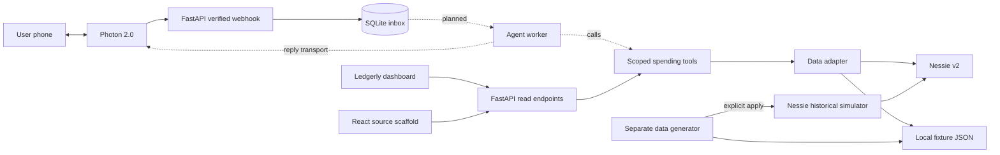

# Spending Companion design and decisions

Status: connected dashboard and spending tools; AI orchestration planned. Updated November 14, 2026.

Current MVP scope: visualize and analyze one pinned Nessie customer through the Ledgerly dashboard and terminal.
Public options live in `settings.toml`; credentials stay in `.env`. Photon is explicitly
disabled until the MVP is complete. The phone architecture below remains the later milestone.

Build a phone-first spending companion: a user texts a question, agents inspect that user's Nessie v2 transactions, and Photon 2.0 carries a concise, evidence-backed answer back to their phone. A small web app shows the same spending information. The hackathon demo should make a spending change understandable and suggest an action the user can choose to take.

## Product idea

The core interaction is a question such as “Why did I spend more this month?” or “Which subscriptions am I paying for?” The answer should name the period, give exact totals, identify the main contributors, and distinguish an observed pattern from a guess. A useful follow-up could narrow the question to dining or show the transactions behind a recurring-charge candidate.

The first demo uses synthetic customers and transactions. Success means one enrolled user can ask from their phone, receive an answer grounded in the same numbers shown on the web page, and ask one contextual follow-up.

## Decisions

| Area | Decision | Status |
| --- | --- | --- |
| Backend | Python 3.12 and FastAPI; typed request and response models | Set up |
| Banking data | Capital One Nessie v2 through a backend-only adapter | Connected; one generated customer pinned in settings |
| Project split | Application under `apps/`; independent package under `data-generator/` | Set up |
| Frontend | Serve the root Ledgerly dashboard; retain the React, TypeScript, and Vite scaffold | Connected charts, balances, filtered transactions, and CSV reports |
| Agents | Provider-neutral tools with deterministic calculations; choose model runtime later | Tools ready; orchestration planned |
| Phone channel | Photon 2.0 Beta, with SMS as the intended demo channel | Boundary ready; provisioning and worker planned |
| Local development | Fixture mode by default; no external service needed | Working |
| Containers | Docker Compose runs FastAPI, Ledgerly behind nginx, and a separate generator | Set up |
| Message persistence | SQLite durable inbox for the single-process demo | Receiver ready; consumer planned |
| Deployment | Local development first; choose hosting when the phone flow is ready | Open |

Nessie v2 uses `https://v2-prod-api.nessieisreal.com`, bearer authentication, integer-cent money fields, and cursor pagination. The adapter follows its [official OpenAPI specification](https://v2.nessieisreal.com/openapi.yaml). Photon 2.0 uses the `https://api.photon.codes/v1` API and its Beta documentation. [Photon version guide](https://photon.codes/docs/llms.txt)

## Architecture

The app never imports or runs the generator. Both agree on the fixture boundary: accounts, merchants, and transactions shaped like the portions of Nessie v2 the app reads. `schema_version: 1` identifies the local fixture format. The shared Python workspace simplifies development; each package has its own manifest and can be installed separately.

The backend is the sole boundary for provider keys and banking data. Ledgerly calls only FastAPI and uses one scoped dashboard response for its charts, balances, tables, and reports. When required, the user enters the shared app bearer token; it stays in page memory and is cleared on lock or reload. Host-facing ports are bound to loopback and serve one configured customer; multi-user authentication is a later milestone.

### Docker runtime

The root `compose.yaml` runs the application without requiring host Python or Node.js. FastAPI listens on container port 8765; nginx serves the root Ledgerly dashboard files on container port 8080 and exposes `/api`, `/health`, and `/webhooks` proxy routes to FastAPI. Host ports remain 8765 for the API and 5173 for the dashboard. The React source scaffold is retained but is not served by the default frontend image. Provider settings are supplied to Python services at runtime.

A one-shot `data-init` service creates a missing fixture before the backend starts. The standalone `generator` service is available through the `tools` profile for intentional generation runs. Both Python services use the `app-data` named volume at `/app/.data`; fixtures and the SQLite inbox survive container recreation, and initial startup never replaces an existing fixture. Host `.data` files are separate. Code changes require rebuilding the images; the native development commands remain available for automatic reloads.

The `dashboard-tests` service in the `tools` profile runs the root dashboard's DOM regression tests in Docker. Use `--env-file .env.example` for credential-free startup and validation.

## Request flow

1. An enrolled user sends a direct text to the project's Photon number.
2. FastAPI verifies the raw request body with the destination's Standard Webhooks secret. It accepts supported text messages only from the configured human sender to the configured agent.
3. The receiver atomically stores the event, message ID, and queued status in SQLite, then acknowledges receipt. Duplicate events or messages do not create another job.
4. **Planned:** a worker claims the queued message, resolves the user's customer and conversation context, and invokes the agent coordinator.
5. **Planned:** the agent chooses a read-only tool and validates its arguments. The tool calculates from the customer's scoped snapshot. A reply writer turns those results into a short answer.
6. **Planned:** the worker persists the exact reply and its stable idempotency key, calls the existing Photon send primitive, then records acceptance and delivery updates separately.

The receiver is implemented through step 3. `send_reply()` is available for the future worker but no route invokes it automatically. A Photon API acceptance is not a delivery confirmation. [Photon webhook contract](https://photon.codes/docs/beta/message-delivery/webhook)

## Agent responsibilities and tools

Start with one coordinator and one bounded tool loop. “Analyst” and “reply writer” are logical responsibilities; they do not require independent services or separate model calls for the first demo.

| Tool | Input | Result | Current behavior |
| --- | --- | --- | --- |
| `get_transactions` | Optional inclusive start/end dates | Normalized transactions | Implemented |
| `summarize_spending` | Optional inclusive start/end dates | Net spending and category totals | Implemented |
| `find_recurring_charges` | Optional inclusive start/end dates | Monthly recurring candidates with evidence transaction IDs | Implemented |
| Compare periods | Two explicit date ranges | Total and category changes | Planned; reuse summary calculations |
| Explain unusual spending | Date range and comparison window | Observations with evidence and confidence | Planned |

Bind `SpendingTools` to an authorized snapshot before exposing methods to a model. Customer and account scope must come from server context, never from an LLM-provided user ID. The runtime must validate tool arguments, cap execution time and tool rounds, and treat merchant descriptions and message text as data rather than instructions. The application exposes no banking write tool.

Keep arithmetic in Python. Model text should quote tool results and identify the date range. If data or a tool fails, say that the analysis is unavailable instead of inventing a total. There is no LLM dependency or model selected in the scaffold yet.

## Money and data semantics

- Store and calculate USD amounts as integer cents; format dollars only at the UI or reply boundary.
- Net spending includes completed purchases, bill payments, fees, and chargebacks, minus completed refunds. Transfers, deposits, interest credits, and cash withdrawals are excluded. This avoids counting a card payment or account transfer as another purchase.
- Pending, declined, and cancelled transactions do not contribute to completed spending.
- Dates are inclusive UTC dates derived from Nessie's `created_at`. Settlement-time reporting and the user's timezone are future decisions.
- A refund inherits its original merchant/category when its parent transaction is available. Otherwise it remains uncategorized. A refund may make a category or date window negative.
- Recurring candidates require at least three completed purchases with the same account, merchant ID, and amount, spaced 25–35 days apart. The label is a candidate, not proof of a subscription. Variable-price subscriptions and annual charges are outside this first detector.
- Read all paginated results before computing totals. Sort transactions by timestamp rather than provider write order. Exceeding the demo page cap fails the request instead of returning partial totals.
- Local fixture balances are illustrative, not a reconciled ledger. The current app analyzes spending and does not infer affordability from those balances.

The app reads customer accounts, merchants, and the tenant transaction list, then scopes the normalized result to the configured customer's account IDs. For larger datasets, add a customer-scoped cache or materialized read model so each request does not traverse the tenant history.

## API and frontend handoff

| Endpoint | Purpose |
| --- | --- |
| `GET /health` | Process health and configured data source |
| `GET /api/v1/dashboard?start=YYYY-MM-DD&end=YYYY-MM-DD` | Unified scoped snapshot for charts, balances, transactions, and recurring candidates |
| `GET /api/v1/accounts` | Configured customer's accounts |
| `GET /api/v1/transactions?start=YYYY-MM-DD&end=YYYY-MM-DD` | Scoped transaction evidence |
| `GET /api/v1/spending/summary?start=...&end=...` | Spending totals and categories |
| `GET /api/v1/spending/recurring?start=...&end=...` | Recurring-charge candidates |
| `GET /api/v1/agent/status` | Optional assistant availability and selected provider |
| `POST /api/v1/agent/answer` | Bounded LangChain question with read-only tools and evidence |
| `POST /api/v1/costar/search` | Filter the supplied local apartment catalog with explicit coverage limits |
| `POST /api/v1/costar/inspect` | Inspect one unambiguous catalog-bound Matterport reference |
| `POST /webhooks/photon` | Signed provider events; durable receipt only |
| `GET /docs` and `GET /openapi.json` | Executable API contract |

The served Ledgerly dashboard shows current cash and card balances, gross expenses by category, refunds, monthly net spending, and searchable transactions. Date filters apply to activity and reports, while balances remain current. CSV exports include all filtered rows across table pages. Recurring charges are labeled candidates. The opt-in question view separates AI interpretation from exact tool evidence and clears pending/stored page results on lock or refresh. Source labels distinguish Nessie from local synthetic fixtures. The retained React starter is not the Docker default. [Frontend handoff](../apps/frontend/README.md)

The optional apartment workflow combines a local CoStar search with one catalog-bound Matterport read. It preserves recorded rent ranges, model-reference scope, modern versus legacy measurement sources, and returned units. Historical availability is not a live quote; scan area is not proof of furniture clearance. Gemini and NVIDIA Nemotron share a sequential LangChain tool loop with bounded turns, calls, output, and duration. Question requests are independent; the Photon worker and persistent conversation context remain deferred.

## Data generator

The generator supports two independent targets:

- **Local:** deterministic fixtures from a seed, end date, and day count. Scenarios include baseline spending and a recent dining increase. The data includes monthly subscriptions, deposits, a transfer, a refund, and pending/declined purchases to exercise exclusions.
- **Nessie:** a dry-run request by default; `--apply` starts Nessie's native historical simulation and saves its run manifest. The manifest contains customer/account IDs for configuring the app. The service generates dates relative to the run time, so a seed alone does not fix calendar dates. Repeating a request may create another dataset. [Nessie simulation schema](https://v2.nessieisreal.com/openapi.yaml)

The generator owns sandbox creation. The application owns read-only analysis. The runtime does not create customers or transactions as a side effect of a request.

## Implementation milestones

| Milestone | Deliverable | Completion check |
| --- | --- | --- |
| 0 — Scaffold | Design, separate packages, local fixture, API, minimal React, automated checks | Complete: local API tests and frontend build |
| 1 — Nessie demo | Generate sandbox history and bind one customer | Account-scoped live totals match an independently checked sample |
| 2 — Agent analysis | Select model/runtime; tool loop; period comparison; evidence-bearing replies | Fixed question set produces correct figures and handles missing data |
| 3 — Phone loop | Provision SMS, connect receiver, implement persistent worker/outbox | A phone question receives one reply; duplicate delivery and restart do not send twice |
| 4 — Demo polish | Frontend teammate's UI; follow-up context; a short demo script | Phone and web show matching totals for the same customer and dates |

The offline automated checks cover exact money arithmetic, exclusions/refunds, customer scope, monthly candidates, dashboard totals, filtering, pagination, CSV safety, stale-request handling, and API authorization/date validation, plus the deferred webhook boundary. Desktop and mobile browser checks exercise the served dashboard with synthetic fixtures. These checks do not load private credentials.

## Next decisions and backlog

- [x] Add Gemini and NVIDIA Nemotron through LangChain with per-question turn, tool, time, and output limits.
- [ ] Choose the demo persona and final app name.
- [ ] Confirm a provisioned Photon **SMS** number. Shared iMessage service is a separate channel and must be presented as such if used for a fallback demo.
- [ ] Add the inbox worker, persisted reply/outbox, retry/backoff, and delivery-status handling.
- [ ] Add one conversation of bounded history per enrolled sender, plus opt-out handling before proactive messages.
- [ ] Replace the shared demo bearer token and single-customer settings with real user authentication and verified phone-to-customer enrollment before opening access.
- [ ] Add user timezone handling, caching, and provider rate-limit backoff. The dashboard already displays retrieval time.
- [ ] Choose deployment for the FastAPI process and persistent database; the webhook requires public HTTPS.

Stretch ideas: weekly spending digests, category budgets, richer recurring-charge detection, unusual-spend comparisons, and a dashboard link from a reply. Keep money movement, automatic subscription cancellation, and unrelated banking operations outside the hackathon MVP.

## Decision log

| Date | Decision | Reason |
| --- | --- | --- |
| 2026-11-13 | FastAPI backend, React frontend, separate generator | Team's chosen stack and division of work |
| 2026-11-13 | Keep local fixture mode and provider adapters | Let backend and frontend development proceed without credentials |
| 2026-11-13 | Use Nessie v2 historical simulations for sandbox seeding | Reuse the provider's supported generator and preserve its returned IDs |
| 2026-11-13 | Leave the LLM provider undecided; implement tools first | Stabilize calculations and scope before choosing the agent runtime |
| 2026-11-13 | Persist verified Photon events before acknowledgment | Make receiver retries safe and leave a clear boundary for the worker |
| 2026-11-14 | Add Docker Compose with a built frontend, separate generator, and persistent data volume | Give teammates one startup command while preserving service boundaries and demo data |
| 2026-11-14 | Pin one generated Nessie customer in readable TOML; retain credentials in `.env`; use terminal tools and defer Photon | Keep the MVP dataset stable and remove messaging setup from the critical path |
| 2026-11-14 | Serve the root Ledgerly prototype and run dashboard regressions through Docker | Make the actual dashboard available through the team's default container workflow |
| 2026-11-14 | Connect Ledgerly visualizations to one protected FastAPI dashboard response; keep Photon disabled | Present consistent customer-scoped figures, date filters, and exports without fabricated sample totals |
| 2026-11-14 | Add opt-in LangChain providers, local CoStar search, and catalog-bound Matterport inspection | Connect questions to scoped evidence while keeping missing measurements and historical availability explicit |
| 2026-11-14 | Connect Ask your books to the question API with separate evidence and incomplete-answer states | Make the implemented tool workflow usable without fabricating conversation history or hiding partial results |
